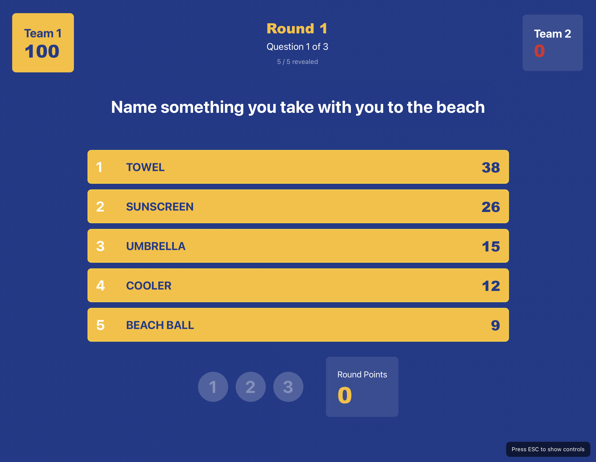

# Virgil Feud

**Picture this:** Your team kickoff just got a whole lot more interesting. Two teams face off, the host reveals the top survey answers, and someone from Sales just shouted "PIVOT TABLE!" as their answer to "Name something everyone pretends to understand." The room erupts. Points are flying. Your company culture just became a game show.

**Welcome to Virgil Feud** – the browser-based Family Feud experience that turns any corporate gathering into an unforgettable competition.


*Watch teams race to 500 points with questions tailored to YOUR company*

---

## Why Virgil Feud?

### 🎉 Team Building That Actually Works
Forget trust falls. Create custom games that test product knowledge, celebrate company traditions, or roast that infamous Slack thread. It's fun, it's competitive, and yes – people will remember which team won the Q4 All-Hands Championship.

### 🧠 Knowledge Testing Disguised as Entertainment
- **Onboarding new hires?** Build a company culture game
- **Product launch coming up?** Test feature knowledge with your team
- **Annual kickoff?** Quiz departments on the year's highlights
- **Just bored?** Make a game about literally anything

### 🎨 Unlimited Customization (Zero Coding Required)
Here's the magic: **Unlimited game files in simple markdown format**. Create as many themed games as you want:
- "Cybersecurity Fails 101" for your security team
- "Sales Objections: The Game" for your GTM org
- "Virtru Product Trivia" for SKO 2026
- "Remote Work Struggles" for Friday team bonding

**And for the tech-savvy teams?** We built an **AI-powered game generator** (yes, really). Feed it a theme, and Claude/ChatGPT will create survey-style questions with realistic answers and point distributions. Built by marketers with zero coding skills, powered by modern AI. *You're welcome.*

### 🎮 Smooth Host Experience
One person controls everything via keyboard shortcuts. No clicking, no lag, no "wait, let me find that button." Reveal answers, track strikes, bank points, switch teams – all from your keyboard. It's like conducting an orchestra, except the orchestra is your coworkers yelling "PASSWORD123!"

---

## What You Get

✅ **Full-Featured Game Show**
- Classic Family Feud gameplay with 3 rounds
- Strike system, point banking, team switching
- Animated answer reveals and confetti celebrations
- Winner screen with your company branding

✅ **Modern Tech Stack** (Built by Marketers, Seriously)
- React 18 + Vite for instant performance
- Tailwind CSS for sleek animations
- Runs entirely in the browser – no backend needed
- One command to start: `npm run dev`

✅ **AI-Powered Content Creation**
- System prompts for Claude Projects & Custom GPTs
- Generates compliant game files automatically
- Phase-based workflow: theme → questions → validation
- See `/prompts/` for the full AI toolkit

✅ **Hosted Anywhere**
- GitHub Pages, Netlify, Vercel – pick your flavor
- Or run locally for office events
- `npm run build` creates a portable game package

---

## Quick Start (Seriously, It's Easy)

**Step 1: Get Node.js**
Already have it? Skip to Step 2. Don't have it? [Download Node.js LTS](https://nodejs.org/) (the green button), install, done.

**Step 2: Fire It Up**
```bash
npm install   # First time only - installs dependencies
npm run dev   # Starts the game
```

**Step 3: Play**
Open your browser to `http://localhost:5173`, pick a game file, enter team names, and press `1-5` to reveal answers. That's it.

**Want to deploy it?** Run `npm run build` and host the `dist/` folder anywhere. GitHub Pages, your company intranet, wherever.

---

## How to Host a Game

The magic is in the keyboard controls. One person (the host) runs the entire show:

### The Essentials
- **`1-5`** → Reveal answers (the bread and butter)
- **`X`** → Add a strike (3 strikes = team switch)
- **`Spacebar`** → Bank points to the active team
- **`S`** → Steal points for the other team
- **`Enter`** → Next question/round
- **`ESC`** → Show/hide the control cheat sheet

### The Flow
1. Teams face off (manually managed – you decide who controls the board)
2. Host reveals answers as teams guess
3. Wrong answers? Hit `X` for strikes
4. After 3 strikes or all answers revealed, bank points with `Spacebar`
5. Hit `Enter` to move to the next question
6. First to 500 points wins (or highest score after 3 rounds)

No mouse needed. No screens to click through. Just pure keyboard-driven game show hosting.

Full control reference: [Requirements/host_controls.md](Requirements/host_controls.md)

---

## Creating Custom Games

### The AI Way (Recommended)

We built system prompts that turn Claude/ChatGPT into game designers:

1. Copy `/prompts/game-file-generator-prompt.md` into Claude Projects or ChatGPT
2. Tell it your theme: "Cybersecurity trivia for employees"
3. The AI asks questions, generates survey-style Q&A, validates format
4. Copy the output to `Game_Questions/your-game.md`
5. Restart the dev server – your game appears in the dropdown

**Why this rocks:** The AI knows your domain, creates realistic answers, ensures compliance, and even adds variety. Built by marketers, validated by the parser.

See [prompts/USAGE_GUIDE.md](prompts/USAGE_GUIDE.md) for full setup.

### The Manual Way

Create a markdown file in `Game_Questions/` like this:

```markdown
## Round 1

### Question 1
**Survey Says: Name something everyone pretends to understand**

1. Blockchain - 35
2. Kubernetes - 28
3. The Cloud - 18
4. Agile Methodology - 12
5. Quantum Computing - 7
```

Repeat for 3 rounds (3 questions each) + Fast Money (3 questions). Save it, restart the server, and boom – new game.

Format details: [Game_Questions/README.md](Game_Questions/README.md)

---

## Technical Deep Dive

### Prerequisites

Before you can run this project, you need to have **Node.js** installed on your machine.

**Need Node.js?** Visit [nodejs.org](https://nodejs.org/), download the LTS version, install. Verify with `node --version` in your terminal.

### Detailed Installation

1. **Clone or download** this repository
2. **Navigate to the folder** in your terminal: `cd /path/to/family_feud`
3. **Install dependencies**: `npm install` (first time only)
4. **Start the server**: `npm run dev`
5. **Open browser**: `http://localhost:5173`

### Building for Production

Deploy anywhere with a static build:

```bash
npm run build        # Creates dist/ folder
npm run preview      # Test the build locally
```

Host the `dist/` folder on GitHub Pages, Netlify, Vercel, or your company's internal servers.

## Features

### Core Gameplay
- 🎮 **Host-Controlled**: Single host operates the game via keyboard
- 👥 **Two Team Competition**: Classic game show format
- 🎯 **3 Regular Rounds**: 3 questions per round, 9 questions total (Fast Money not yet playable)
- ⌨️ **Full Keyboard Controls**: Complete host interface with shortcuts
- 🏆 **Auto-Scoring**: First to 500 points or highest after all rounds
- 🔄 **Auto-Switch**: Teams automatically switch after 3 strikes

### Visual Polish
- 🎨 **Modern UI**: React, Tailwind CSS, and Framer Motion
- 🔄 **Flip Animations**: Vertical card flip when revealing answers
- 💥 **Shake Effects**: Strike indicators shake on impact
- 🎯 **Counting Animations**: Points count up smoothly
- 🎊 **Confetti Celebration**: Winner screen with falling confetti
- 👁️ **Toggle Controls**: ESC key to show/hide host controls overlay

### Audio & Content
- 🔊 **Sound System**: Plays effects for reveals, strikes, banking (optional sound files)
- 📝 **Multiple Games**: Automatically loads all .md files from Game_Questions folder
- ✏️ **Easy Customization**: Simple markdown format for creating new games
- ⚡ **Fast Performance**: Built with Vite for instant hot reload

## Project Structure

```
family_feud/
├── Game_Questions/          # Markdown files with game questions
│   ├── sample.md           # Sample question format
│   └── README.md           # Game file format guide
├── prompts/                # AI prompt system for creating game files
│   ├── game-file-generator-prompt.md  # Main system prompt
│   ├── USAGE_GUIDE.md                 # Setup & usage instructions
│   └── FORMAT_QUICK_REFERENCE.md      # Format cheat sheet
├── Requirements/           # Project documentation
│   ├── todo.md            # Development task list
│   └── host_controls.md   # Keyboard controls reference
├── docs/                  # Documentation assets
│   ├── QUICKSTART.md      # Quick setup guide
│   └── screenshot.png     # Game screenshot (add your own)
├── src/                   # Source code
│   ├── components/        # React components
│   │   ├── MainMenu.jsx      # Main menu screen
│   │   ├── TeamSetup.jsx     # Team setup screen
│   │   ├── GameBoard.jsx     # Main game board
│   │   └── GameOver.jsx      # Winner screen
│   ├── utils/            # Utility functions
│   │   └── questionParser.js # Markdown parser
│   ├── hooks/            # Custom React hooks
│   │   ├── useSounds.js      # Sound effects hook
│   │   └── useCountUp.js     # Counting animation hook
│   ├── assets/           # Images, sounds, etc.
│   ├── App.jsx           # Main app component
│   ├── main.jsx          # App entry point
│   └── index.css         # Global styles
├── public/               # Static assets
│   └── sounds/           # Sound effect files (optional)
├── index.html           # HTML entry point
├── package.json         # Dependencies and scripts
├── vite.config.js       # Vite configuration
├── tailwind.config.js   # Tailwind CSS configuration
└── README.md           # This file
```


## Technologies Used

- **React 18**: UI framework
- **Vite**: Build tool and dev server
- **Tailwind CSS**: Utility-first styling
- **Framer Motion**: Animations
- **JavaScript (ES6+)**: Programming language

## Troubleshooting

### Port Already in Use
If you see "Port 5173 is already in use":
- Stop any other Vite/development servers running
- Or change the port in `vite.config.js`

### Dependencies Not Installing
- Make sure you have a stable internet connection
- Try deleting `node_modules` folder and `package-lock.json`, then run `npm install` again
- Make sure you're using Node.js version 18 or higher

### Game Not Loading
- Check the browser console for errors (F12 or right-click > Inspect)
- Make sure the dev server is running (`npm run dev`)
- Try clearing browser cache and reloading

## License

This project is for educational and entertainment purposes.

## Current Status

**✅ FULLY FUNCTIONAL & PRODUCTION-READY!**

The game is complete and polished with all planned features implemented!

**Core Features:**
- ✅ Main menu with multiple game file selection
- ✅ Team setup and name entry
- ✅ Complete game board with all controls
- ✅ Answer reveal system with vertical flip animations
- ✅ Strike system with shake animations (auto-switches at 3 strikes)
- ✅ Point banking and stealing mechanics
- ✅ Smooth counting animations for all scores
- ✅ Round progression through all 3 rounds
- ✅ Win condition checking (500 points or end of rounds)
- ✅ Winner screen with confetti effects
- ✅ Sound effects system (graceful fallback if files missing)
- ✅ ESC key to toggle host controls overlay
- ✅ Multiple game file support (auto-detects all .md files)
- ✅ Complete game flow from menu to winner

**Possible Future Enhancements:**
- Face-off buzzer system for question starts
- Fast Money bonus round
- Additional sound effects and music
- More elaborate animations
- Mobile/tablet optimization

See [Requirements/todo.md](Requirements/todo.md) for development history.

## Adding Your Own Screenshot

To replace the screenshot with your own:

1. Run `npm run dev` and navigate to the game board
2. Take a screenshot (Cmd+Shift+4 on Mac, Win+Shift+S on Windows)
3. Save as `screenshot.png` in the `docs/` folder (overwrites existing)
4. The README will automatically display your new screenshot!

## Support & Documentation

For additional help, refer to:
- [docs/QUICKSTART.md](docs/QUICKSTART.md) - Quick setup guide
- **[prompts/USAGE_GUIDE.md](prompts/USAGE_GUIDE.md) - AI game file generator setup**
- **[prompts/FORMAT_QUICK_REFERENCE.md](prompts/FORMAT_QUICK_REFERENCE.md) - Format cheat sheet**
- [Requirements/host_controls.md](Requirements/host_controls.md) - Complete keyboard reference
- [Game_Questions/README.md](Game_Questions/README.md) - How to create custom games manually
- [Requirements/todo.md](Requirements/todo.md) - Development history
- [public/sounds/README.md](public/sounds/README.md) - How to add sound effects
