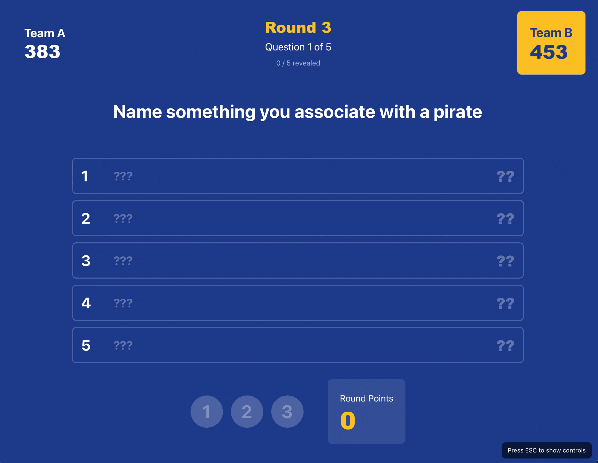

# Virgil Feud

**Picture this:** Your team kickoff just got a whole lot more interesting. Two teams face off, the host reveals the top survey answers, and someone from Sales just shouted "PIVOT TABLE!" as their answer to "Name something everyone pretends to understand." The room erupts. Points are flying. Your company culture just became a game show.

**Welcome to Virgil Feud** – the browser-based Family Feud experience that turns any corporate gathering into an unforgettable competition.


*Watch teams race to 500 points with questions tailored to YOUR company*

---

## Why Virgil Feud?

### 🎉 Team Building That Actually Works
Forget trust falls. Create custom games that test product knowledge, celebrate company traditions, or roast that infamous Slack thread. It's fun, it's competitive, and yes – people will remember which team won the Q4 All-Hands Championship.

### 🧠 Knowledge Testing Disguised as Entertainment
- **Onboarding new hires?** Build a company culture game
- **Product launch coming up?** Test feature knowledge with your team
- **Annual kickoff?** Quiz departments on the year's highlights
- **Just bored?** Make a game about literally anything

### 🎨 Unlimited Customization (Zero Coding Required)
Here's the magic: **Unlimited game files in simple markdown format**. Create as many themed games as you want:
- "Cybersecurity Fails 101" for your security team
- "Sales Objections: The Game" for your GTM org
- "Virtru Product Trivia" for SKO 2026
- "Remote Work Struggles" for Friday team bonding

**And for the tech-savvy teams?** We built an **AI-powered game generator** (yes, really). Feed it a theme, and Claude/ChatGPT will create survey-style questions with realistic answers and point distributions. Built by marketers with zero coding skills, powered by modern AI. *You're welcome.*

### 🎮 Smooth Host Experience
One person controls everything via keyboard shortcuts. No clicking, no lag, no "wait, let me find that button." Reveal answers, track strikes, bank points, switch teams – all from your keyboard. It's like conducting an orchestra, except the orchestra is your coworkers yelling "PASSWORD123!"

---

## What You Get

✅ **Full-Featured Game Show**
- Classic Family Feud gameplay with 3 rounds
- Strike system, point banking, team switching
- Animated answer reveals and confetti celebrations
- Winner screen with your company branding

✅ **Modern Tech Stack** (Yes, Marketers Built This)
- **React 18 + Vite** – We Googled what these were. Turns out they're fast.
- **Tailwind CSS** – Finally, a way to style things without crying.
- **Framer Motion** – Makes things go *whoosh* when they shouldn't.
- **On GitHub** – We learned what a pull request is. Our developer friends are confused.
- **No backend** – Because we definitely couldn't build one.
- **One command to start**: `npm run dev` – We memorized this. It's basically our superpower now.

✅ **AI-Powered Content Creation**
- System prompts for Claude Projects & Custom GPTs
- **Game Generator**: Creates compliant game files automatically
- **Host Sheet Generator**: Transforms games into print-friendly answer sheets
- **Blend Games**: Intelligently combines 2-3 existing games with built-in validation
- **Game Quality Analyzer**: Expert gameplay analysis with scoring, balance checking, and rebalancing suggestions
- Phase-based workflow with automatic format validation
- Works everywhere: Claude Code, Claude.ai, ChatGPT, n8n
- See `/prompts/` for the full AI toolkit

---

## Quick Start (For Marketers Who've Never Done This Before)

### Step 0: Get This Project on Your Computer

**On this GitHub page**, look for the green `<> Code` button near the top. Click it, then click **"Download ZIP"**.

Unzip the file somewhere you can find it (like your Desktop or Documents folder).

### Step 1: Install Node.js (One-Time Thing)

**What's Node.js?** It's what makes this game run on your computer. Think of it like installing Microsoft Office, except free and way less annoying.

1. Go to [nodejs.org](https://nodejs.org/)
2. Click the green button that says **"LTS"** (it'll have a version number)
3. Install it like any other program
4. You're done. Seriously, that's it.

**How do I know it worked?** Don't worry about it. If Step 2 works, you're good.

### Step 2: Open the Scary Black Box (It's Not Scary)

**On Mac:**
- Open **Terminal** (press `Cmd + Space`, type "terminal", hit Enter)

**On Windows:**
- Open **Command Prompt** (press `Windows Key`, type "cmd", hit Enter)

You'll see a black (or white) box with text. This is your terminal. You're a developer now. Congratulations.

### Step 3: Navigate to Your Project

Type this, but replace `path/to/your/folder` with where you actually unzipped the project:

**Mac/Linux:**
```bash
cd ~/Desktop/family_feud
```

**Windows:**
```bash
cd C:\Users\YourName\Desktop\family_feud
```

**Pro tip:** You can drag the folder into the terminal window and it'll type the path for you. Magic.

Press **Enter**. If nothing breaks, you did it right.

### Step 4: Install the Game's Dependencies

Copy this, paste it in your terminal, press Enter:

```bash
npm install
```

You'll see a bunch of text fly by. That's normal. It's downloading stuff. Takes 1-2 minutes.

**When it stops and you see your terminal prompt again, you're ready.**

### Step 5: Start the Game

Type this and press Enter:

```bash
npm run dev
```

You'll see something like:
```
Local: http://localhost:5173
```

**Copy that URL** (it might be a different number) and paste it into your web browser.

### Step 6: Play!

The game loads in your browser. Pick a game file from the dropdown, enter team names, and press `1-5` on your keyboard to reveal answers.

**To stop the game:** Go back to that terminal window and press `Ctrl + C`.

---

### "I Messed Something Up"

No worries. Close the terminal, open a new one, and start from Step 3.

### "I Want to Share This With My Team"

See the "Building for Production" section below. Or just send them this GitHub repo and tell them to follow these steps.

---

## How to Host a Game

The magic is in the keyboard controls. One person (the host) runs the entire show.

**Pro Tip:** Generate a print-friendly host answer sheet using our AI-powered [Host Sheet Generator](/prompts/host-sheet-generator.md). Get clean, scannable reference sheets in three formats (Minimal, Standard, or Detailed). See examples in `/docs/host/`.

### The Essentials
- **`1-5`** → Reveal answers (the bread and butter)
- **`X`** → Add a strike (3 strikes = team switch)
- **`Spacebar`** → Bank points to the active team
- **`S`** → Steal points for the other team
- **`Enter`** → Next question/round
- **`ESC`** → Show/hide the control cheat sheet

### The Flow
1. Teams face off (manually managed – you decide who controls the board)
2. Host reveals answers as teams guess
3. Wrong answers? Hit `X` for strikes
4. After 3 strikes or all answers revealed, bank points with `Spacebar`
5. Hit `Enter` to move to the next question
6. First to 500 points wins (or highest score after 3 rounds)

No mouse needed. No screens to click through. Just pure keyboard-driven game show hosting.

---

## Creating Custom Games

### The AI Way (Recommended)

We built system prompts that turn Claude/ChatGPT into game designers:

1. Copy `/prompts/game-generator.md` into Claude Projects or ChatGPT
2. Tell it your theme: "Cybersecurity trivia for employees"
3. The AI asks questions, generates survey-style Q&A, validates format
4. Copy the output to `Game_Questions/your-game.md`
5. Restart the dev server – your game appears in the dropdown

**Why this rocks:** The AI knows your domain, creates realistic answers, ensures compliance, and even adds variety. Built by marketers, validated by the parser.

See [prompts/README.md](prompts/README.md) for full setup.

### The Manual Way

Create a markdown file in `Game_Questions/` like this:

```markdown
## Round 1

### Question 1
**Name something everyone pretends to understand**

1. Blockchain - 35
2. Kubernetes - 28
3. The Cloud - 18
4. Agile Methodology - 12
5. Quantum Computing - 7
```

Repeat for 3 rounds (4-5 questions each recommended, 3 questions supported for legacy files) + Fast Money (3 questions). Save it, restart the server, and boom – new game.

Format details: [docs/GAME_FILE_FORMAT.md](docs/GAME_FILE_FORMAT.md)

---

## Technical Deep Dive

### Prerequisites

Before you can run this project, you need to have **Node.js** installed on your machine.

**Need Node.js?** Visit [nodejs.org](https://nodejs.org/), download the LTS version, install. Verify with `node --version` in your terminal.

### Detailed Installation

1. **Clone or download** this repository
2. **Navigate to the folder** in your terminal: `cd /path/to/family_feud`
3. **Install dependencies**: `npm install` (first time only)
4. **Start the server**: `npm run dev`
5. **Open browser**: `http://localhost:5173`

### Building for Production (AKA: Putting Your Game on the Internet)

Remember how `npm run dev` runs the game on your computer? That's great for testing, but nobody else can access it. To share it with the world (or just your company), you need to **build** it.

**What does building do?**

It takes all your code and creates a folder called `dist/` with optimized, production-ready files. Think of it as packaging your game into a neat little box that works on any web server.

**How to build:**

```bash
npm run build
```

That's it. You'll see a new `dist/` folder appear with your game inside.

**Now what?**

Take the **contents** of that `dist/` folder (the files inside, not the folder itself) and upload them to literally any web hosting service. Once they're online, anyone with the URL can play your game.

**Where can you host it?**

The beauty of this game? It's just HTML, CSS, and JavaScript files. No databases, no servers, no backend wizardry. That means you can stick it anywhere that serves web pages:

- **Your company's website** (if you have access – ask your web team)
- **Netlify** (drag & drop the folder, get a URL – tell your dev friends you "deployed to Netlify" and watch them nod approvingly)
- **GitHub Pages** (free hosting from GitHub – makes you look extra technical)
- **Vercel** (another trendy option developers love)
- **AWS S3** (if you're feeling fancy and have an AWS account)
- **Your internal file server** (if IT set up web hosting)
- **Any FTP server** (old school, but it works)

**To test your build locally before deploying:**

```bash
npm run preview
```

This simulates how the game will behave in production. If it works here, it'll work anywhere.

**Pro Tip:** After you build, the `dist/` folder is disposable. You can delete it and rebuild anytime with `npm run build`. It's not tracked in Git (that's what `.gitignore` is for), so don't worry about committing it.

## Features

### Core Gameplay
- 🎮 **Host-Controlled**: Single host operates the game via keyboard
- 👥 **Two Team Competition**: Classic game show format
- 🎯 **3 Regular Rounds**: 4-5 questions per round, 12-15 questions total (Fast Money not yet playable)
- ⌨️ **Full Keyboard Controls**: Complete host interface with shortcuts
- 🏆 **Auto-Scoring**: First to 500 points or highest after all rounds
- 🔄 **Auto-Switch**: Teams automatically switch after 3 strikes

### Visual Polish
- 🎨 **Modern UI**: React, Tailwind CSS, and Framer Motion
- 🔄 **Flip Animations**: Vertical card flip when revealing answers
- 💥 **Shake Effects**: Strike indicators shake on impact
- 🎯 **Counting Animations**: Points count up smoothly
- 🎊 **Confetti Celebration**: Winner screen with falling confetti
- 👁️ **Toggle Controls**: ESC key to show/hide host controls overlay

### Audio & Content
- 🔊 **Sound System**: Plays effects for reveals, strikes, banking (optional sound files)
- 📝 **Multiple Games**: Automatically loads all .md files from Game_Questions folder
- ✏️ **Easy Customization**: Simple markdown format for creating new games
- ⚡ **Fast Performance**: Built with Vite for instant hot reload

## Project Structure

```
family_feud/
├── Game_Questions/          # Markdown files with game questions
│   ├── sample.md           # Sample question format
│   └── README.md           # Game file format guide
├── prompts/                # AI prompt system for creating content
│   ├── game-generator.md       # Game content generator
│   ├── host-sheet-generator.md # Host answer sheet generator
│   ├── README.md               # Setup & usage instructions
│   └── format-reference.md     # Format cheat sheet
├── Requirements/           # Development & project management
│   └── todo.md            # Development history & planning
├── docs/                  # Documentation assets
│   ├── host/              # Host answer sheet examples
│   ├── screenshot.png     # Gameplay screenshot
│   └── GAME_RULES_SLIDES.md  # Game rules presentation
├── src/                   # Source code
│   ├── components/        # React components
│   │   ├── MainMenu.jsx      # Main menu screen
│   │   ├── TeamSetup.jsx     # Team setup screen
│   │   ├── GameBoard.jsx     # Main game board
│   │   └── GameOver.jsx      # Winner screen
│   ├── utils/            # Utility functions
│   │   └── questionParser.js # Markdown parser
│   ├── hooks/            # Custom React hooks
│   │   ├── useSounds.js      # Sound effects hook
│   │   └── useCountUp.js     # Counting animation hook
│   ├── assets/           # Images, sounds, etc.
│   ├── App.jsx           # Main app component
│   ├── main.jsx          # App entry point
│   └── index.css         # Global styles
├── public/               # Static assets
│   └── sounds/           # Sound effect files (optional)
├── index.html           # HTML entry point
├── package.json         # Dependencies and scripts
├── vite.config.js       # Vite configuration
├── tailwind.config.js   # Tailwind CSS configuration
└── README.md           # This file
```


## Troubleshooting

### Port Already in Use
If you see "Port 5173 is already in use":
- Stop any other Vite/development servers running
- Or change the port in `vite.config.js`

### Dependencies Not Installing
- Make sure you have a stable internet connection
- Try deleting `node_modules` folder and `package-lock.json`, then run `npm install` again
- Make sure you're using Node.js version 18 or higher

### Game Not Loading
- Check the browser console for errors (F12 or right-click > Inspect)
- Make sure the dev server is running (`npm run dev`)
- Try clearing browser cache and reloading

## License

This project is for educational and entertainment purposes.

## Documentation & Resources

### For Users
- **[prompts/README.md](prompts/README.md)** - AI generators setup (game files + host sheets + quality analyzer)
- **[prompts/format-reference.md](prompts/format-reference.md)** - Game file format cheat sheet
- **[docs/GAME_FILE_FORMAT.md](docs/GAME_FILE_FORMAT.md)** - Manual game creation guide
- **[docs/GAME_RULES_SLIDES.md](docs/GAME_RULES_SLIDES.md)** - Game rules presentation slides
- **[docs/host/README.md](docs/host/README.md)** - Host answer sheet guide & examples
- **[public/sounds/README.md](public/sounds/README.md)** - Adding custom sound effects

### For Developers
- **[Requirements/todo.md](Requirements/todo.md)** - Development history & project planning
- **[prompts/game-generator.md](prompts/game-generator.md)** - Game generator system prompt
- **[prompts/host-sheet-generator.md](prompts/host-sheet-generator.md)** - Host sheet generator system prompt
- **[prompts/blend-games.md](prompts/blend-games.md)** - Game blending system prompt
- **[prompts/game-quality-analyzer.md](prompts/game-quality-analyzer.md)** - Game quality analyzer system prompt
